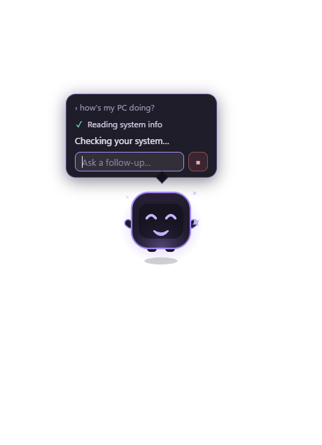

# EngineBuddy

A small animated character that lives on your Windows desktop, talks like a friend, and uses
**Claude Code on your own claude.ai subscription** to actually help: answer questions, check how
your PC is doing, open programs and folders, and run commands, but only after you click **Allow**.



- Click it to ask something. Right-click for the menu (System check, Open in VS Code…, Pause).
- It reacts to what it's doing: thinking, talking, working, happy, confused.
- It never runs anything risky without you: every command is shown to you word for word in a
  separate confirmation window first. Some things (formatting disks, switching off Defender,
  reading your passwords) are refused even if you click Allow.
- It never bills per request: it only runs on your claude.ai login, never on an API key.

**Status:** Phase 1 done, plus starting programs and confirmed commands from Phase 2. Windows only
for now. See [ROADMAP.md](ROADMAP.md).

## Requirements

- **Windows 10 or 11** (64-bit).
- **Claude Code**, installed and logged in with your claude.ai account (Pro or Max):
  1. Install it: <https://docs.claude.com/en/docs/claude-code/setup>
  2. Open a terminal, run `claude`, and log in once. That's all EngineBuddy needs.

  Without Claude Code, EngineBuddy still starts, says so, and runs on a practice script.

## Install

Download from the [Releases](../../releases) page:

| File | What |
|---|---|
| `EngineBuddy-Setup-<version>.exe` | Installer (Start menu + desktop shortcut, uninstall from Windows settings) |
| `EngineBuddy-<version>-portable.exe` | No install: just run it |

The builds aren't code-signed, so Windows SmartScreen will say "Windows protected your PC". Click
**More info → Run anyway**, or build it yourself (below) if you'd rather not trust a download.

## Run from source

Needs [Node.js](https://nodejs.org) 22.18 or newer.

```bash
git clone <this repository>
cd EngineBuddy
npm install
npm run dev
```

If it complains that Electron failed to install, fetch its binary once:

```bash
node node_modules/electron/install.js
```

Build your own installer and portable exe (written to `release/`):

```bash
npm run dist
```

## Using it

| Do | How |
|---|---|
| Ask something | Click the avatar, type, Enter. Esc closes the bubble |
| Stop an answer | The ■ button in the bubble |
| Move it | Drag it. Drop it near a corner and it snaps there |
| Resize it | Ctrl + mouse wheel over it |
| Menu | Right-click: Ask, System check, Open in VS Code…, Pause/Resume, Exit |
| Hide / pause / quit | The tray icon (left-click shows/hides it) |

Things to try: "how's my PC doing?", "open a terminal in D:\code\myproject", "what's taking up space
in my Downloads folder?" (asks before running anything).

## Settings

`%APPDATA%\enginebuddy\settings.json`. Created on first run; edit it while EngineBuddy is closed.

| Setting | Default | What |
|---|---|---|
| `projectRoots` | `[]` | Folders it may read without asking, e.g. `["D:\\code\\myproject"]`. The first is where it works and runs commands. With none, it uses an empty folder of its own |
| `agent` | `"claude-code"` | `"mock"` = a practice script, no Claude, no usage |
| `claudeExecutable` | auto | Path to `claude.exe` if it isn't found automatically |
| `claudeModel` | Claude Code's default | e.g. `"sonnet"` |
| `bubbleDismissSeconds` | `12` | How long a reply stays up |
| `scale`, `positions` | | Remembered size and position |

Every tool request, allowed or refused, is logged in `%APPDATA%\enginebuddy\logs\` (kept 30 days).

## Safety

EngineBuddy is a language model with hands on your PC, so it's built on the assumption that the
model can be wrong or tricked (by a file it reads, say). In short:

- **Safe things run directly:** system info, opening a fixed list of programs (Explorer, Terminal,
  VS Code, Notepad, Task Manager, Calculator), reading files in your project folders.
- **Commands need your click** in a separate window that shows the exact command, the folder, and
  EngineBuddy's reason (labelled as such). Cancel is the default; Enter never means yes; no answer
  in 2 minutes means no.
- **Some things are always refused:** passwords, browser data, SSH keys, `.env` files, wiping
  disks, switching off security, hidden or self-starting commands.

Details: [SECURITY.md](SECURITY.md) (the permission model) and
[docs/security-audit.md](docs/security-audit.md) (what was checked, what was fixed, what risks remain).

## For developers

| Command | What |
|---|---|
| `npm run dev` | Run with hot reload |
| `npm run check` | Typecheck + lint + format check + tests (run before every commit) |
| `npm test` | Unit tests only, no Claude usage |
| `EB_INTEGRATION=1 npx vitest run test/integration` | Live test against real Claude (uses your subscription) |
| `npm run dist` | Windows installer + portable exe in `release/` |

- [ARCHITECTURE.md](ARCHITECTURE.md): how it's built and why
- [docs/decisions/](docs/decisions/): one record per step (what was built, why, how it was verified)
- [CLAUDE.md](CLAUDE.md): the rules for working on this code with Claude Code

## License

[MIT](LICENSE) © 2026 EngineGames-Development
