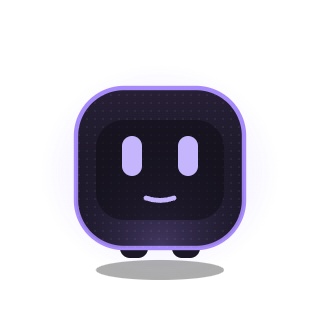
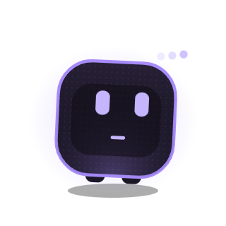
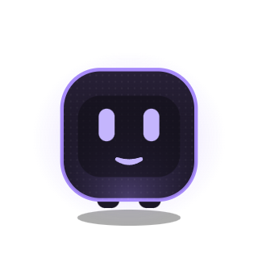
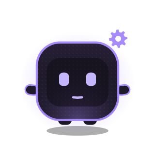
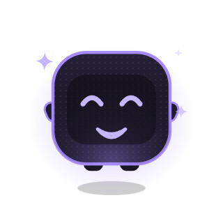
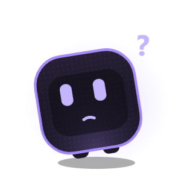
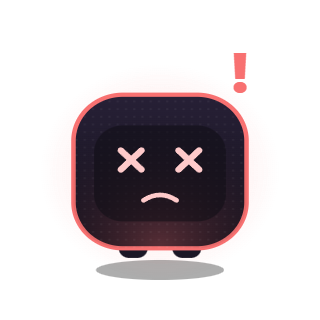
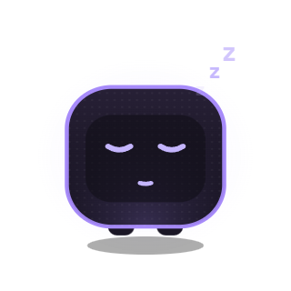

# 006 — Avatar engine (Phase 1, step 4)

Date: 2026-11-01

## What exists now

All in `src/renderer/avatar/`:

| File | Role |
|---|---|
| `state-machine.ts` | AvatarStateMachine: ongoing state + held reactions, priority, hold, Sleep override, debug override |
| `reactions.ts` | The event → state table |
| `poses.ts` | Pose per state (data), fallbacks for states without art, per-state loops |
| `tween.ts` | Pose blending: eased numbers, discrete parts switch at the midpoint, squash impulse |
| `engine.ts` | The single animation loop: transitions, loops, blinks, glances, throttling |
| `rig.ts` | The SVG character, built once and updated by attributes |
| `Avatar.tsx` | Mounts it; BuddyEvents → reactions → state machine → engine; Ctrl+Alt+D cycles states |

## Character concept (design checkpoint)

Captured from the running app (`docs/images/avatar/`):

| IDLE | THINKING | TALKING | WORKING |
|---|---|---|---|
|  |  |  |  |
| **HAPPY** | **CONFUSED** | **ERROR** | **SLEEPING** |
|  |  |  |  |

Charcoal rounded-square body, violet rim and inner glow, faint pixel-grid texture, a dark "screen"
panel with pill eyes, stubby arms that only appear when gesturing, a soft shadow. ERROR shifts the
rim and glow to red. Effects: thinking dots, a gear, sparkles, `?`, `!`, drifting `z`s.

**This needs your OK before polishing** (docs/PHASE-1.md step 4). Everything visual is data in
`poses.ts` and a few constants in `rig.ts`, so changes are cheap.

## Decisions

1. **The state machine lives in the renderer, not `src/core/state`** as ARCHITECTURE.md §10
   sketched. Renderers may only import `shared`, and only the avatar window uses it. It's still
   pure TS with no DOM, and unit-tested.
2. **Two layers: ongoing state and held reaction.** The latest ongoing state wins (events arrive
   in order). A held reaction stays for its hold time; a higher priority interrupts it, a lower
   one waits. When the hold ends, the avatar goes back to whatever the ongoing state is *by then*.
3. **SLEEPING has its own art** (8 states, not 7), because Pause needs it from step 3 on. The
   other 6 fall back: SUCCESS/EXCITED → HAPPY, CODING → WORKING, SURPRISED/WORRIED → CONFUSED,
   LISTENING → IDLE.
4. **Only the body is "solid".** `data-hit`/`data-drag` sit on the body group, so the glow,
   shadow and effects stay click-through.
5. **Throttling.** Calm states (IDLE, SLEEPING, CONFUSED) run at 6 fps, with full rate only during
   transitions, blinks and glances; busy states run on rAF. The loop stops while the window is
   hidden. At 12 fps idle measured 2.06 % CPU (total, 4 cores); at 6 fps, 1.58 %.

## Verified

- 20 unit tests: state machine (holds, interrupts, return state, Sleep, override), every state
  resolves to art, and the reactions table turns three scripted event streams (a plain question,
  a system check, a denied tool) into the expected state sequences.
- Every state rendered in the built app (captured over the DevTools protocol).
- Idle cost, built app, no DevTools attached, 20 s sample: **1.58 % CPU** of the whole machine
  (6.3 % of one core) and 326 MB working set across 4 processes. The GPU process is most of it:
  every frame recomposites the large transparent window. Phase 6's target (< 1 %) will need
  fewer idle frames or a smaller window.
