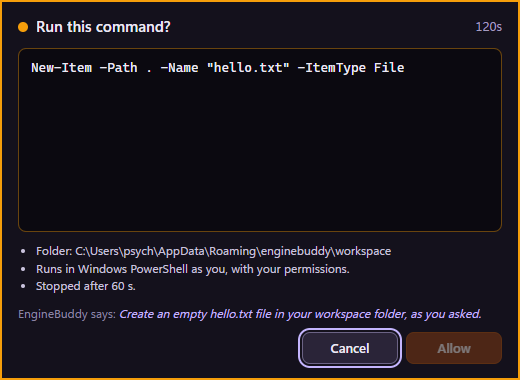

# 013 — Starting programs safely: app allowlist, run_command, confirmation window

Date: 2026-11-01 · Your choice: "Both" (allowlisted apps without asking + any command behind a confirmation)

This pulls the CONFIRM tier and the confirmation window forward from Phase 2.

## What exists now

| Piece | Where |
|---|---|
| `open_application` (SAFE): explorer, terminal, vscode, notepad, task_manager, calculator; optional folder for the first three | `src/tools/applications/open-application.ts` |
| Shared launcher: executable + argument array, detached, never a shell | `src/tools/applications/launch.ts` |
| `run_command` (CONFIRM): Windows PowerShell, 60 s limit, output cut at 16 kB, killed with its children on cancel/timeout | `src/tools/terminal/run-command.ts` |
| Escalate-only command classifier (BLOCKED even with your OK) | `src/security/policy/command-classifier.ts` |
| ConfirmationBroker: one at a time, 2 min time-out → no, Allow delay, cancel withdraws | `src/security/confirmations/confirmation-broker.ts` |
| Confirmation window, owned by main | `src/main/windows/confirm-window.ts`, `src/renderer/confirm/` |
| `ToolDef.describe()` builds what the window shows, from validated input | `src/core/tools/tool-def.ts` |

## How a command runs

1. The model calls `run_command { command, cwd?, reason }`.
2. PolicyEngine: classifier → BLOCKED if it matches; secret `cwd` → BLOCKED; else **CONFIRM,
   confirmable** (our tool, and it can describe itself).
3. Both Claude Code gates let a *confirmable* request through (audited as `ask`); every other
   CONFIRM (built-in Bash, Write, …) is still denied, because we don't run those and couldn't show
   you exactly what would run.
4. The ToolRunner asks the broker → the confirmation window shows the literal command, the folder,
   and the model's reason labelled "EngineBuddy says:".
5. Only "allowed" runs it. Denied / time-out / cancelled turn → not run, audited `by: user`, and
   the model is told not to retry.

## Decisions

1. **Defence in depth on the answer.** Main accepts an answer only from the confirmation window
   currently showing that request (`owns(webContents, id)`), on its own IPC channel, schema-checked.
   The avatar renderer has the same preload API but its answers are ignored. The broker itself
   ignores an Allow that arrives within 500 ms of showing, so even a compromised confirm page
   can't auto-approve instantly.
2. **Cancel is the default** (SECURITY.md §5): focus on Cancel, Enter and Esc mean no, closing
   the window means no, Allow needs a click or Tab + Space, the window is above the avatar
   (`pop-up-menu` level) so the bubble can't cover it, and it has a fixed amber frame.
3. **The model must give a reason**, but it's shown separately and labelled. You judge the command
   text, not the description.
4. **The classifier only blocks.** Disk/boot/backup destruction, recursive deletes of a drive or
   Windows, security switches (Defender, firewall, UAC, execution policy, HKLM), hidden commands
   (`-EncodedCommand`, base64, download-and-execute), persistence (scheduled tasks, Run keys,
   services) and anything naming credential stores, keys or `.env` files. Everything else still
   needs your click. Regex can't prove a command safe, and it's never asked to.
5. **Bash stays listed but denied**, with "use run_command instead", so the model learns the right
   tool and the denial path stays tested.
6. **Pause and quit deny everything pending**; cancelling a turn withdraws its request and kills a
   running command.
7. **open_application never takes an executable path or arguments from the model**: a name from
   the list, plus an optional existing folder. Task Manager is started through Explorer because it
   auto-elevates. No browser entry: opening a browser without a URL is rarely what you want, and
   URLs are web access (CONFIRM, later).

## Verified

- 41 new tests (`test/security/confirmations.test.ts`): 22 blocked commands, 8 everyday commands
  left to you, app launch plans, open_application policy, broker (Allow delay, time-out, wrong id,
  queue, denyAll, cancel), run_command through the runner with real PowerShell (runs only after
  Allow, output captured, audited; not run on No; blocked commands never shown).
- Live with Claude, built app:
  - "Show me the current date and time by running Get-Date" → `run_command Get-Date` → window →
    Allow → `Exit code 0` → "It's Sunday, 1 November 2026, 10:08:50". Audit: hook `ask`,
    canUseTool `ask`, user `allow`, runner `result`.
  - "Create a file called hello.txt …" → window showed `New-Item -Path . -Name "hello.txt" -ItemType File`,
    Allow disabled at first, Cancel focused → Cancel → not created; audit `user deny`; Claude:
    "you said no … so I didn't create hello.txt".
- `open_application`: unit-tested with a fake launcher; not launched live, to avoid opening windows
  on your desktop unasked.
